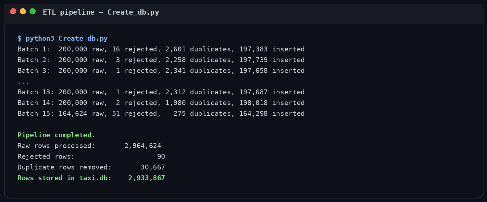
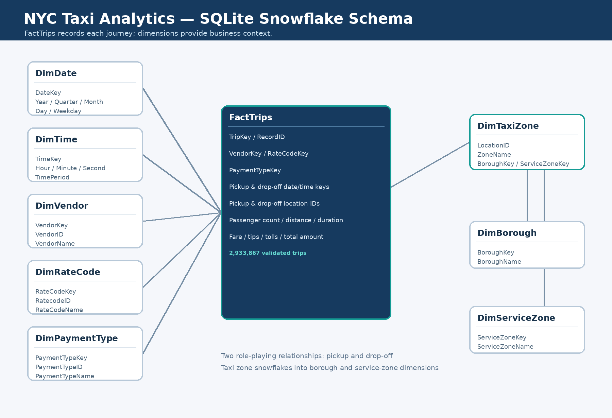
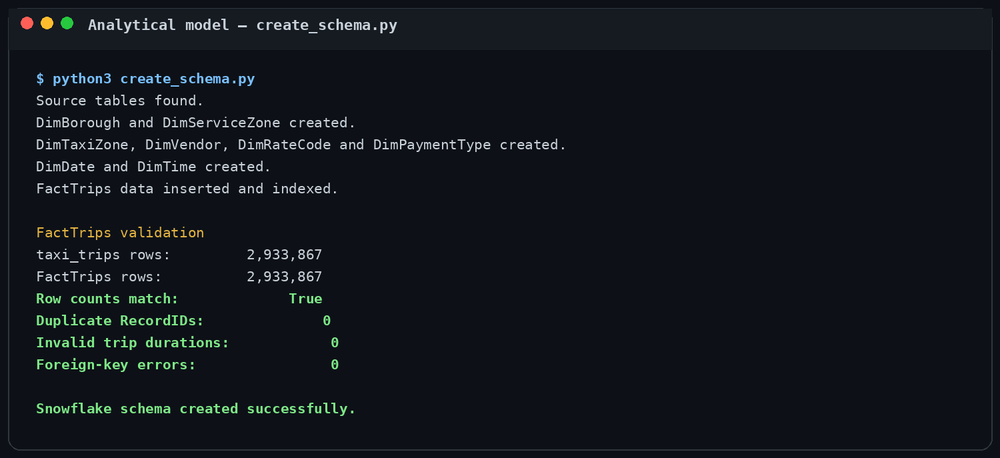

# NYC Taxi Data Analytics Pipeline

A portfolio data-engineering and analytics project built with **Python, Pandas, PyArrow, SQLite and Power BI-ready SQL modelling**. It processes almost 3 million NYC Yellow Taxi journeys, validates and cleans the source data, records a reusable quality audit, and creates a snowflake-style analytical model.

## Project result

| Metric | Result |
|---|---:|
| Raw trip records processed | 2,964,624 |
| Rejected records retained for review | 90 |
| Duplicate records removed | 30,667 |
| Clean records loaded | 2,933,867 |
| Duplicate IDs after loading | 0 |
| Invalid trip durations after loading | 0 |
| Foreign-key errors | 0 |


## Pipeline steps

1. **Extract** — read the Yellow Taxi Parquet file in batches of 200,000 rows and load the taxi-zone CSV lookup.
2. **Inspect** — count missing values, invalid timestamps, invalid reporting dates, negative monetary values, invalid locations and duplicates.
3. **Audit** — aggregate the findings and corrections in `audit/data_quality_report.json`.
4. **Clean** — convert data types, replace selected missing values, standardize categories, convert valid monetary fields to positive values and reject unusable records.
5. **Preserve exceptions** — store rejected rows and their rejection reasons separately for investigation.
6. **Load** — insert clean records into SQLite and prevent duplicate record IDs.
7. **Validate** — compare expected and actual database row counts and rerun quality checks.
8. **Model** — transform the clean tables into a snowflake-style reporting model centred on `FactTrips`.

## ETL execution

The batch process limits memory usage and prints the result of every load operation.



The complete machine-readable outcome is available in [`audit/data_quality_report.json`](audit/data_quality_report.json).

## SQL analytical model

`FactTrips` contains one row per validated taxi journey. Dimension tables describe the date, time, vendor, rate, payment method and geographic context of each trip.



### Tables

| Table | Purpose | Rows |
|---|---|---:|
| `FactTrips` | Validated taxi journeys and numeric measures | 2,933,867 |
| `DimDate` | Calendar attributes | 32 |
| `DimTime` | Second-level time attributes | 86,400 |
| `DimTaxiZone` | Pickup and drop-off zones | 265 |
| `DimBorough` | Borough names | 7 |
| `DimServiceZone` | Taxi service-zone groups | 5 |
| `DimVendor` | Technology providers | 5 |
| `DimRateCode` | Trip-rate categories | 8 |
| `DimPaymentType` | Payment categories | 8 |

### Schema validation



The source and fact-table counts match, and the completed model contains no duplicate record IDs, invalid trip durations or foreign-key errors.

## Repository contents

```text
viz_data_taxiNY/
├── Create_db.py
├── create_schema.py
├── RawData/
│   ├── yellow_tripdata_2024-01.parquet
│   └── taxi_zone_lookup.csv
├── audit/
│   └── data_quality_report.json
├── docs/images/
├── taxi-data-pipeline.png
└── .gitignore
```

## Database files

> **The generated SQLite databases are not uploaded to GitHub.**

`SQLData/taxi.db` contains millions of rows and exceeds GitHub's normal file-size limit. `SQLData/inc_Data_taxi.db` contains rejected records and is also generated locally. Both files are excluded by `.gitignore` and can be recreated from the included source data and Python scripts.

Generated locally:

```text
SQLData/taxi.db
SQLData/inc_Data_taxi.db
```

## Run locally

Create and activate a virtual environment:

```bash
python3 -m venv .venv
source .venv/bin/activate
python -m pip install --upgrade pip
python -m pip install pandas pyarrow python-dotenv
```

Create a `.env` file in the project root:

```env
MAIN_PATH=/absolute/path/to/viz_data_taxiNY
```

Run the ETL pipeline and then create the reporting schema:

```bash
python Create_db.py
python create_schema.py
```

The first script creates and validates the clean and rejected-data databases. The second script builds the dimension tables, `FactTrips`, indexes and final relationship checks.

## Data source

- [NYC TLC Trip Record Data](https://www.nyc.gov/site/tlc/about/tlc-trip-record-data.page)
- Dataset: January 2024 Yellow Taxi trip records
- Lookup: NYC taxi-zone reference data

## Technology

- Python
- Pandas
- PyArrow
- SQLite
- JSON audit reporting
- Power BI-ready dimensional modelling

